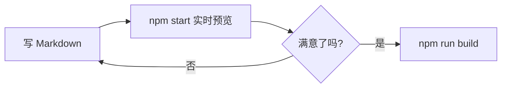

这篇文章演示主题支持的全部 Markdown 增强语法，可以作为写作时的速查参考。

## 提示块（GitHub Alerts）

> [!NOTE]
> 强调用户应该注意的信息。

> [!TIP]
> 可选的技巧，能帮助用户更高效地完成任务。

> [!WARNING]
> 需要谨慎操作，可能有风险的内容。

## 任务列表

- [x] 支持任务列表语法
- [x] 可以勾选和取消
- [ ] 待办事项

## 高亮与脚注

使用双等号可以标记==重点内容==，也可以添加脚注[^1]。

[^1]: 这是一个脚注的示例内容。

## 代码块

带语言标注的代码块会自动语法高亮：

```js
// Eleventy 数据文件示例
module.exports = {
  title: "示例标题",
};
```

## Mermaid 图表

直接用代码块书写流程图：



## 表格与引用

| 语法 | 用途 |
| --- | --- |
| `> [!NOTE]` | 提示块 |
| `==文本==` | 高亮 |
| `脚注[^1]` | 引用说明 |

> 引用块示例：好的文档结构比华丽的辞藻更重要。
